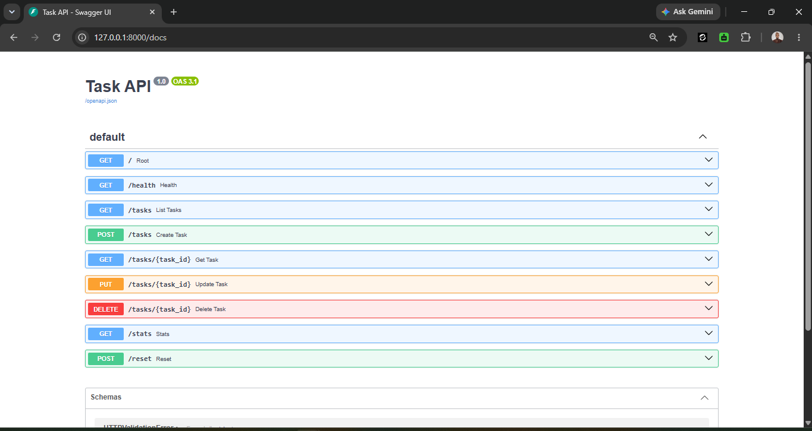

# Task API

A small to-do list API built with Python and FastAPI. It supports full CRUD
(create, read, update, delete) on tasks stored in memory (no database).

## Install and run

You need [uv](https://docs.astral.sh/uv/) installed (it also fetches the right
Python for you).

```bash
git clone https://github.com/YOUR-USERNAME/task-api.git
cd task-api
uv sync
uv run fastapi dev main.py
```

The server runs at http://localhost:8000 and the interactive docs at
http://localhost:8000/docs.

## Endpoints

| Method | Path | Description | Success | Errors |
|---|---|---|---|---|
| GET | `/` | API info | 200 | |
| GET | `/health` | Health check | 200 | |
| GET | `/tasks` | List all tasks | 200 | |
| GET | `/tasks/{id}` | Get one task | 200 | 404 |
| POST | `/tasks` | Create a task | 201 | 400 |
| PUT | `/tasks/{id}` | Update a task | 200 | 400, 404 |
| DELETE | `/tasks/{id}` | Delete a task | 204 | 404 |

## Example

```
(paste the real output of: curl -i http://localhost:8000/tasks/1 )
```

## Swagger UI



## Notes

Data is stored in memory only, so it resets whenever the server restarts.
