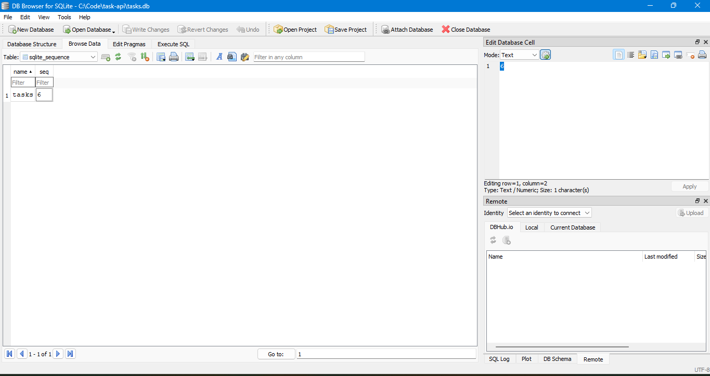

# Task API

A small to-do list API built with Python and FastAPI. It supports full CRUD
(create, read, update, delete) on tasks. Tasks are stored in a SQLite
database, so they survive server restarts.

## Install and run

You need [uv](https://docs.astral.sh/uv/) installed (it also fetches the right
Python for you).

```bash
git clone https://github.com/YOUR-USERNAME/YOUR-REPO.git
cd YOUR-REPO
uv sync
uv run fastapi dev main.py
```

The server runs at http://localhost:8000 and the interactive docs at
http://localhost:8000/docs. The database is created automatically on first run.

## Endpoints

| Method | Path | Description | Success | Errors |
|---|---|---|---|---|
| GET | `/` | API info | 200 | |
| GET | `/health` | Health check | 200 | |
| GET | `/tasks` | List all tasks | 200 | |
| GET | `/tasks/{id}` | Get one task | 200 | 404 |
| POST | `/tasks` | Create a task | 201 | 400 |
| PUT | `/tasks/{id}` | Update a task | 200 | 400, 404 |
| DELETE | `/tasks/{id}` | Delete a task | 204 | 404 |

All errors return JSON in the form `{"error": "..."}`.

## Example

```
<<FILL IN: paste the real output of: curl -i http://localhost:8000/tasks/1 >>
```

## Swagger UI


## Why SQLite

<<FILL IN, in your own words. Points to cover: it is a single file, it needs
no server to install, and data survives restarts.>>

## Where the database lives

The database is the file `tasks.db`, next to `db.py`. It is created
automatically when the app starts, and the `tasks` table is created if it is
missing. Three example tasks are inserted only when the table is empty. The
file is listed in `.gitignore`, so every clone starts with a fresh database.

All database code lives in `db.py`. `main.py` only contains the routes and
calls functions from `db.py`.

## Database screenshot



## SQL I ran by hand

```sql
<<FILL IN: one real query you ran in DB Browser, for example:
SELECT COUNT(*) FROM tasks WHERE done = 1;>>
```

<<FILL IN: one honest sentence about what it returned.>>

## Notes

- Every query uses `?` placeholders, never values glued into the SQL text, to
  prevent SQL injection.
- <<FILL IN (optional): one line from the "prove the API didn't change" stretch.
  The same tests passed against the in-memory and SQLite versions. Passing
  identical tests proves the storage is an implementation detail: clients
  depend only on the API's behaviour, not on where the data lives.>>

<!-- Delete the sections below if you did not do these extras. -->

## Extras

### Filter, search and sort

`GET /tasks?done=true`, `GET /tasks?search=word` and `GET /tasks?sort=title`.

### Stats

`GET /stats` returns the counts of total, done and open tasks.

### Timestamps and migrations

<<FILL IN: two sentences in your own words. What happened when you added the
new columns to an existing table, and why migrations exist.>>