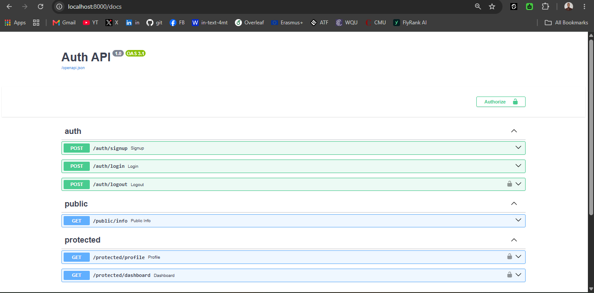

# Auth API

A FastAPI backend that uses Supabase Auth for sign-up, login and logout,
verifies bearer tokens and protects routes with one reusable guard.

## Setup

1. Create a free project at supabase.com.
2. In **Authentication → Sign In / Providers → Email**, turn **Confirm email** off
   (practice only).
3. Copy your **Project URL** and **publishable key** (starts with `sb_publishable_`) from the dashboard.
   Never use the secret/service_role key.
4. Create the environment file:

       cp .env.example .env      # then fill in your own values

5. Install [uv](https://docs.astral.sh/uv/), then install and run:

       uv sync
       uv run fastapi dev main.py

Server: http://localhost:8000 · Docs: http://localhost:8000/docs

## Environment variables

| Variable | Meaning |
|---|---|
| `SUPABASE_URL` | Your project URL |
| `SUPABASE_KEY` | Your publishable key |

## API reference

| Method | Path | Auth needed | Success | Errors |
|---|---|---|---|---|
| POST | `/auth/signup` | No | 201 | 400 |
| POST | `/auth/login` | No | 200 | 400, 401 |
| POST | `/auth/logout` | Bearer token | 204 | 401 |
| GET | `/protected/profile` | Bearer token | 200 | 401 |
| GET | `/protected/dashboard` | Bearer token | 200 | 401 |
| GET | `/public/info` | No | 200 | n/a |

## Swagger UI

